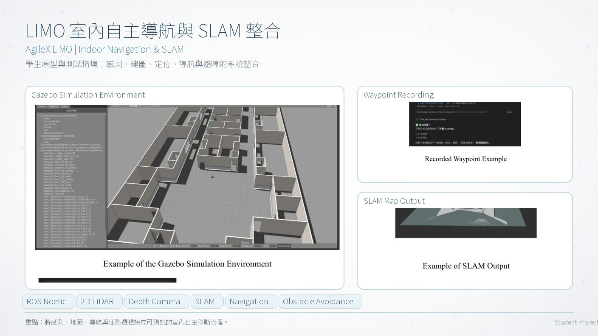

# LIMO Autonomous Navigation Prototype

A student robotics prototype for indoor autonomous navigation on an AgileX LIMO platform. The target use case is medical-item delivery; this repository documents the navigation and system-integration work, not a deployed hospital service.



## What this case study covers

- ROS Noetic integration for a mobile robot platform
- 2D LiDAR and depth-camera sensing
- Mapping and localization with GMapping and AMCL
- Global planning with A* and local obstacle avoidance with DWA
- Gazebo-based testing, including semantic-command and VLN exploration

## System view

1. **Sense**: LiDAR and depth data describe the indoor environment.
2. **Map and localize**: a map and robot pose support repeatable navigation tasks.
3. **Plan and react**: global planning supplies a route while local planning reacts to obstacles.
4. **Execute a task**: a command is translated into a navigation goal.

## Evidence and limits

The included figures are public presentation assets that show the architecture and Gazebo workflow. They are qualitative evidence of an educational prototype. This repository does not claim a hardware success rate, a safety certification, or a production deployment. See [docs/evidence.md](docs/evidence.md).

## Repository layout

```text
assets/       Public system and simulation figures
docs/         Evidence scope and limitations
```

## Reuse

This is a portfolio case study rather than a turnkey robot package. Recreate the runtime with your own ROS workspace, robot configuration, maps, and sensor calibration.

## License

Apache-2.0. See [LICENSE](LICENSE).
